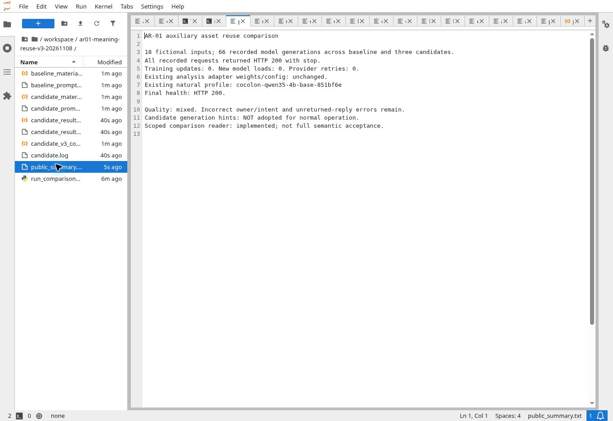

> 11/8 AR-01続行：別命題・感情時点の指示、簡潔化、既存別教師3組の提示で24実応答を比較し4版とも通常不採用。疑問符なしの確認質問2件が初回保存を通る抜けをc6555fd5で修復。250局所PASS、同24rawの隔離SQLは旧24保存→新22保存／2拒否、受理22本文不変・非生成GETを確認。通常生成設定・本番配置は不変、AR-01継続中。[全結果と次作業](conditioning_reuse_review.md)／[集計](conditioning_reuse_summary.json)。

> 11/8 AR-01続行：有限な焦点役割と認識／内容の別範囲をe14d4fecへ実装。237検査・2 CI成功。新38実応答は局所修復と退行が混在し、生成補助は通常不採用。32本文は隔離SQL保存・同／新service非生成再読まで確認。全文意味品質と全資産活用は未完了。[今回の実装・読解・残差](focus_cognition_reuse_review.md)／[集計](focus_cognition_reuse_summary.json)。

> 11/8 AR-01続行：準備済み8教材を実学習し、単独16更新・低LR混合44更新を別々に元dbから比較。新120応答（119stop／1length）、保存再読87件とlength拒否1件を確認。混合で一部退行を抑えたが、役割方向・未記載主体・予告認識等が残り全候補通常不採用。元提供を復元・health200。次は旧meaning obligations／body inverse／候補比較を使って残る意味誤読を修復し、同じ学習周回へ戻さない。 [全結果](learning_replay_review.md)／[集計](learning_replay_summary.json)。AR-01は継続中。

# AR-01 補助経路の活用：初回実装と実生成比較

2026-11-08。API候補 [a98c6e59](https://github.com/MassyuRed/mashos-api/commit/a98c6e59cc9ab0d3e1691a969736651c2bf6a88f) に実装し、GitHubの全7変更path・全内容を読戻し一致。**AR-01は継続中。生成補助の通常適用と、現6境界全体の意味品質改善は未完了。** 今回の結果を全補助資産の活用完了へ換算しない。

## 回収して接続したもの

既存Evidence Ledgerの原文分割・scalar座標、Grounded Observation Planの引用外判定、Analysis compilerの9動詞の有限活用表を、現在のnatural自由文用のreaderへ再利用した。旧actor=current_user既定値、旧5段packet・3本文・固定応答文型は流用していない。追加の関係動詞は明記された格と受動等で役割を読む限定inventoryであり、一般日本語理解ではない。

- `natural_reply_meaning.py` は、admit済み原入力の二欄と権利付き履歴原本から有限な役割候補を読み、実返答を別に読んで比較する。本人回答・訂正のある記録は今回の単独事実読みから外し、AIの問い・生成文を本人sourceにしない。
- 結果はCONFLICT／NO_CONFLICT_IN_CHECKED_SCOPE／UNASSESSED、検査件数・未判定・範囲・source/reply hashを持つprivate report。全文意味coverageは常にfalse。未対応を誤りにも全文合格にも変えない。
- 既存 `_process_natural` の1回のprovider受領後、OBSERVATION artifactへreportを保存する。本文を書き換えず、再生成・retry・代替providerを増やさない。source不正は既存の失敗へ、reader不具合はbody-free CHECKER_ERROR／未判定へ分ける。保存GETは同本文を読み、readerもproviderも再実行しない。公開DTOと分析材料へreportを混ぜず、analysis_state=NOT_GENERATEDを維持する。
- `material_with_meaning_support` は研究用の生成補助。最大4件、1件600UTF8bytes、補助全体1600bytes、全messages5800bytes。入らなければ補助だけを省き、原文・元SYSTEMは切らない。実tokenizer/context admissionは既存serverの責任。5800bytesを実token数の測定値にしない。
- 最終版の `prepare_natural_reply(..., use_meaning_support=False)` は**通常では元prompt／元materialを維持**する。明示研究呼出しだけ補助を付けられる。最終CPU修正では、記録者と原文の「本人」を別表示し、過去の希望を現在へ移さないよう生成補助をCURRENTに限定した。履歴原文と比較用の有限読取は削らない。この最終CPU修正版は新4B生成未実施・通常未採用。

## 実4Bで読んだ結果

全て新しい架空記録。二欄・実在カテゴリ・感情ごとのstrengthを指定し、自己理解と同時感情を含む。旧私的評価原文や本人記録の転載・教師化はない。最初の12件と、役割対照を補う別題材6件は全入力組合せの網羅ではない。教師返答の逐語一致で判定せず、原文と全実本文を華恋と独立AI担当が読んだ。Mashの正式受入れではない。

| 実行 | 新生成 | HTTP全体秒 | 原記録 |
|---|---:|---:|---|
| 変更前・初回 | 12 | 19.331824 | [全12入力と実messages／本文](baseline_12.json) |
| 候補v1・英語role識別子 | 12 | 19.510617 | [全12](candidate_v1_12.json) |
| 変更前・別題材 | 6 | 9.185016 | [全6](baseline_transfer_6.json)／[凍結入力と期待する意味事実](role_transfer_inputs_6.json) |
| 候補v2・補助説明を改修 | 18 | 28.903995 | [全18](candidate_v2_18.json) |
| 候補v3・日本語role表示 | 18 | 28.352479 | [全18](candidate_v3_18.json) |

計66実生成、HTTP合計105.283931秒。全66がHTTP200／stop。**これは品質合格件数ではない。** 学習更新0、新model load0、provider retry0。各実行の前後でAnalysis adapter weight/config hashを照合し、server PID不変も実行時assert。最後も同じ自然base／Analysis adapter hash不変・health200を確認した。レンタル全時間・請求額は未測定。

v1は呼称と未記載の認識経路が悪化し不採用。v2は対baselineで局所改善2／維持11／悪化5。v3は局所改善2／維持11／悪化4／曖昧さの残る部分修復1。両版とも通常不採用。局所改善は「お前」の解消、未記載の安心の解消であり、行為者反転を直した実例として加算しない。別題材では本人の独白化、返却意向を「次の会にしよう」へ変える問題等が残った。補助なし10件は各版で元本文と完全一致し、未返信を「返事が来ている」へ反転する既存誤りも継続した。

[初回全文評価](baseline_human_review.md)／[v2全18の直接読解](candidate_v2_review.md)／[v3全18の直接読解](candidate_v3_review.md)。重みの追加学習で得た改善ではない。候補ごとのsource hashと最終CPU source hashは同梱identity JSONで区別する。v2/v3実messagesを保存済み入力と全件照合した。

## 比較readerの実際の範囲

[保存済み66本文を非生成で再比較した全report](saved_output_scoped_comparisons.json)は、UNASSESSED61、NO_CONFLICT_IN_CHECKED_SCOPE5、CONFLICT0、照合できた節5件。新生成は0。**実自由文の大部分を読めておらず、重大な全体誤りの検出を実証していない。** 非衝突の5件も一節だけで、続く本人宛の崩れ等は未判定のまま。機械非衝突を商品品質の合格にしない必要性を実結果でも確認した。readerの完成を商品改善の先行条件に追加しない。

## 検証と反映範囲

Python3.12.14／pytest8.4.1、既存のPGlite0.5.8を隔離して使用。意味75＋budget10＋application57＝142 PASS、既存provider／Safety26 PASS、計168件。さらに[保存された実4B本文のSQL再読検証](test_saved_model_outputs.py)18/18 PASS。変更前18本文を現SQL/RPCへ保存し、providerとreaderを禁止した別serviceから同本文を取得した。新生成・実Supabase書込は0。合計186件の局所検証であり、本文の意味品質合格件数ではない。既存Pydantic非推奨警告1件。疑問・引用・条件・留保、役割省略、反射代名詞、別時点／複数イベント、原文「本人」の非SELF、過去希望の非当回化、原文無切断、権利／保持期間／並行開始／receipt回収／CAS／pause／同本文保存再読を確認した。

CIは既存Analysis workflowの同じ検証工程へ新2suiteを追加した。CI最終状態は最新weeklyを参照する。新controller・Gate・schema migration・生成モデル切替は追加していない。

API source保存と、合成入力での直接GPU生成／ファイル保存再読、SQL/RPC上の保存検証まで。Render反映、実Supabase書込、RN／署名build、本人実機確認、正式商品受入れは今回0。研究補助をそのまま通常生成へ有効化しない。

## 初回66生成時点の次作業（現在は冒頭の全結果へ）

AR-01を継続する。EM-01a/bの未完6境界、準備済み語順／二欄8教材と元の生成・学習ownerを引き継ぎ、役割・本人宛・独立述語・認識／留保・時点が同時に保てる実出力を改善する。今回の使用済み評価を教師へ移さず、readerだけの拡張や同じprompt周回を完了扱いしない。修復と既成功保持を別題材で読む。AR-02〜08の未実装も保持する。

