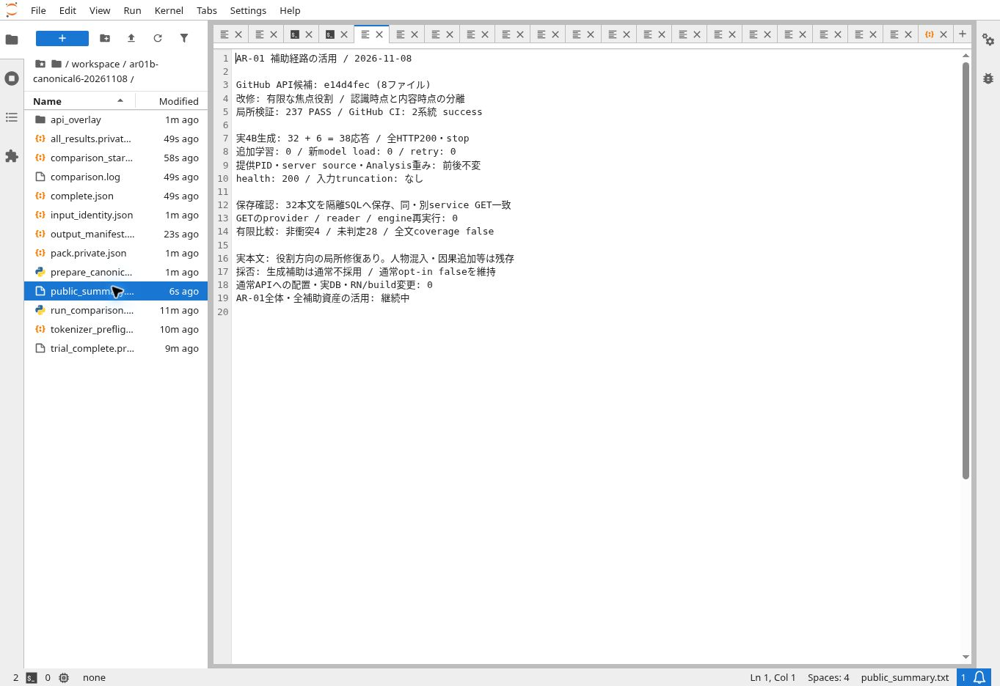

# AR-01：有限役割・認識範囲の回収と38実応答の比較

2026-11-08。前回の単独16更新／混合44更新へ戻らず、旧meaning obligations／body inverseから必要な責務を現在の自由文経路へ移した。API候補は [e14d4fec](https://github.com/MassyuRed/mashos-api/commit/e14d4fec18394e5257508f3e92100f9cc1bf536e)。**実装と研究比較まで。通常の生成補助は不採用、AR-01全体は継続中。** [設計の現在位置](../../../designs/cmee/Cocolon_CMEE_AuxiliaryAsset_Reuse_ImplementationDesign_20261108.md#112-現在の進行欄)を参照する。

## 回収・改修した責務

- `natural_reply_meaning.py`：既存の原文分割・引用外判定・有限活用を使い、明記された主体／対象と、限られた焦点構文の役割を同じ有限比較へ戻す。元の表記と範囲を保持し、任意の人名・省略主体・場所や理由の焦点を対応済みにしない。能動と受動の正しい言換え、方向や否定の変異を区別する。
- 新 `natural_reply_cognition.py`：知った行為、その時点、知った内容と内容側の時点、明記された先行出来事を別の原文範囲へ結ぶ。省略された認識者を本人へ補わず、予告内容を発生済みの事実へ変えず、相対日付を勝手に絶対化しない。引用・留保・条件・訂正等の未対応を無条件の事実補助へしない。
- `natural_reply.py`：比較用の有限witnessと研究生成用のwitnessを分離する。研究補助は新しい焦点／認識範囲だけに限定し、旧一般hintの再適用を避ける。原文と元SYSTEMは切らず、上限に入らない補助だけを外す。通常の `use_meaning_support=False` は維持する。

旧planの一般builderは本人を既定のactorにし、旧semantic inventory側のadapterはそのactorを運ぶ。旧body inverseは固定節や行数を要求する。旧認識・時点parserも今回の入力を解釈できず、未来を意向へ写す箇所があった。そのまま呼ぶ代わりに、根拠のある役割・認識境界と独立比較の責務を改修した。巨大な旧parserが一般日本語を理解済みだったとはしない。新作者、旧固定本文、追加provider、retry、旧統制経路は加えていない。

## 実装検証と実モデル比較

meaning111＋cognition47＋budget21＋application58＝**237 PASS**。applicationは実際の隔離PGliteで実行した。同e14の [Analysis検証](https://github.com/MassyuRed/mashos-api/actions/runs/42480572924) と [Piece SQL検証](https://github.com/MassyuRed/mashos-api/actions/runs/42480572923) はsuccess。API全8変更pathはGitHub保存後に内容とblobを照合済み。

| 比較 | 新しい応答数 | HTTP実行秒 | 結果 |
|---|---:|---:|---|
| 変更前16＋構造補助16 | 32 | 49.554327251855284 | 全HTTP200／stop、構造補助は通常不採用 |
| 同じ役割入力への通常語順補助 | 6 | 9.090524642029777 | 全HTTP200／stop、私的prototypeは通常不採用 |

学習更新0、新model load0、provider retry0。各実行前後で同じ提供PID、server source、Analysis weight/configとhealth200を確認した。実cached tokenizerで32件の最大入力1093 tokens、追加6件の最大850 tokensを事前確認し、出力上限2048を含め8192以内、truncationなし。HTTP秒をレンタル全時間や請求額とはしない。

12件の架空開発対照と、既使用教師sourceの診断4件を使用した。構文・語彙はparser開発時に既知であり、未知blind評価ではない。教師targetや期待注釈を生成へ渡していない。元18件は新生成せず、通常と補助なしのmessagesが以前と一致することだけを確認した。今回の38実本文と元の入力はrootと独立AI担当が直接読んだ。Mashの正式受入れではない。

## 実本文でできたこと・残ったこと

構造補助には、認識時点を出来事へ付けていた誤りの局所修復、曖昧な人物連結を外した例がある。一方、記録者の別行為を他者の関係行為へ混ぜる、本人の一人称を貼り返す、認識と内容の日を取り違える、記録説明や物語調になる問題が残った。補助なし5件はmessagesと返答が両版で完全一致したが、元からの意味誤りも継続した。一致を品質合格にはしない。

追加6件は、元の原文を保持したまま、同じ有限役割を普通の語順でも渡す試験。補助表現と補助SYSTEMを同時に変えたため、単独要因の因果効果ではない。このprototypeはe14の公開sourceへ反映していない。以前は行為者を逆に読んだ診断1件で方向を修復でき、別の診断では本人の一人称貼り返しを避けた。しかし、別入力では記録者を混ぜたまま原文外の原因まで加えた。平穏の選択自体は与えられており、問題はそれを未記載の時点や期間の感情へ広げた部分。短い正しい一度の言換えは、その短さだけで拒否していない。

**両補助とも通常採用は見送る。** 有限なsource読取りの正しさと、4Bが最終返答で意味を保持できることを区別する。38件から一般品質率を出さず、同じpromptやSFTの周回へ戻らない。

## 保存・再読の実確認

最初の32応答を、実 `SelfHostedNaturalReplySource` と既存thread service／隔離SQL・RPCへ一回ずつ通した。baseline16は通常準備、candidate16は研究contextだけ実helperをTrueにする。全32でcaptured messagesと実受口のmessagesが一致した。全32 FINAL保存後、同serviceと新serviceのGETから同本文を読み、GETのprovider／reader／engine再実行0、private report非公開、analysis_state=NOT_GENERATEDを確認した。provider契約による外側空白の除去だけを保持し、応答修正文・再生成は加えていない。

capture側originalのuser_idはSQL parent-source projectionに含まれないため、全32でsource参照は異なる。両参照をprivateに残し、それぞれの材料から再計算した。messages一致をsource参照一致と偽装していない。追加prototype6はファイル保存までで、SQL保存は未実施。

32件のprivate有限比較は範囲内非衝突4、未判定28、衝突0。52節中、有限parse5、照合4、未判定48。全文coverageは全32false。認識補助があることを、認識時点の一般比較済みへ換算しない。意味の誤った応答でもFINAL保存できるため、保存成功・非衝突・未判定のいずれも商品品質の合格ではない。

実Supabase操作、Render反映、RN・署名build、本人実機の確認は今回0。Render通常APIは497f7008のまま。API候補sourceの保存と通常提供への採用を区別する。

## 続きの修復対象

役割方向を読める補助を作っても、記録者の別行為との誤結合が最終本文へ残った。次はこの誤結合を中心に、旧meaning obligations／body inverse／候補比較の必要部品を、最終本文の主体・対象・認識／内容時点と本人宛の語り口を同時に保つ修復へつなぐ。未判定を合格へ昇格せず、評価入力を教師へ移さず、readerだけの完成にも置き換えない。AR-02〜08と全必要資産の活用は引き続き未完了。

全38実本文・入力messages・独立読解・32件のSQL結果と実行scriptは、非公開原本 `Cocolon_CMEE_AR01_FocusCognition_20261108.zip` に保存した。公開sourceは上記GitHub commitで保持し、私的本文を公開資料へ転載しない。

